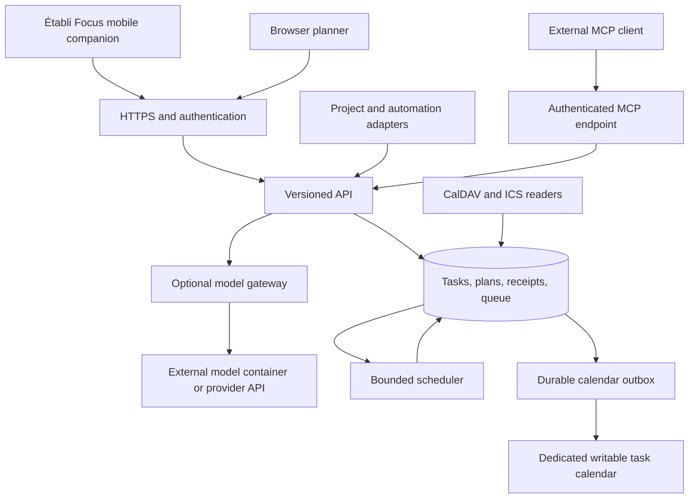

# Architecture

## One product, one application image

The proposed baseline is Python with FastAPI, a deterministic scheduling module and a compiled TypeScript browser client. Package the API, static client and background jobs in one application image. SQLite on a local persistent volume is the initial database; a single writer coordinates mutations. Use the database for the durable job queue and outbox rather than introducing Redis or another database service.

This favors a small personal deployment. Revisit PostgreSQL and separate workers for multiple replicas or sustained multi-user contention. Do not put the SQLite database on a network share.

## Scheduling engine

Use minute-based intervals with configurable rounding and explicit handling of any remainder. Expand recurring events only within the planning horizon, with bounded lookback for overlapping events. Subtract busy intervals and buffers from allowed hours. Topologically order dependencies; prioritize urgency and priority, then fit remaining effort into admissible windows.

Begin with a deterministic heuristic and a separate constraint validator. Preserve unaffected blocks, then optimize deadline attainment, priority, movement, fragmentation and workload distribution in a documented order. The UI explains trade-offs, including lower-priority work that could not fit.

Prototype OR-Tools CP-SAT only if the baseline cannot meet acceptance cases. Bound solver time and worker count. FEASIBLE is not OPTIMAL; UNKNOWN is not proof of infeasibility. Always validate output. On timeout, retain only still-valid existing blocks or a validated fallback, and expose remaining work. See [OR-Tools status documentation](https://developers.google.com/optimization/cp/cp_solver/) and [solver limits](https://developers.google.com/optimization/cp/cp_tasks).

Calendar change → ingest transaction → debounce → immutable input revision → candidate plan → constraint validation → revision comparison → commit plan and outbox. If inputs changed during calculation, discard the candidate and retry. Only one scheduling run per account may publish at a time.

## Data model

| Entity | Important fields |
| --- | --- |
| Task | UUID, list, title, notes, estimated minutes, priority, deadline, earliest start, status, revision |
| Series / occurrence | Rule, time zone, local deadline, exceptions, stable occurrence key |
| Dependency | Predecessor, successor, validated acyclic relation |
| Availability profile | Weekly windows, local zone, dated exceptions |
| Calendar connection | Provider, collections, credential reference, capabilities, freshness |
| External event | Provider UID, recurrence ID, ETag, original time semantics, busy interval |
| Plan / block | Input revision, task occurrence, interval, pinned/active state, explanation |
| Progress receipt | Unique client/session ID, cumulative credited minutes, task, timestamps |
| External mapping | Provider object ID, local UUID, ownership, last synchronized values |
| Outbox / audit | Idempotency key, intended change, attempt state, result, recovery evidence |

Store instants in UTC together with the original IANA zone and local recurrence rule. Store all-day dates as dates. Preserve imported legacy IDs as aliases; they are not new primary keys.

## API contract to implement

- `GET /api/v1/tasks`, `POST /api/v1/tasks`, `PATCH /api/v1/tasks/{id}`; pagination and revision preconditions.
- `GET /api/v1/schedule?from=...&to=...`; stable blocks, freshness and plan revision.
- `POST /api/v1/tasks/{id}/progress`; client session UUID and cumulative productive minutes, reconciled monotonically.
- `POST /api/v1/tasks/{id}/complete`; explicit action, idempotency key and task revision.
- `POST /api/v1/plans/preview`, `POST /api/v1/plans/recalculate`; changes and shortages visible before manual publication.
- `POST /api/v1/blocks/{id}/pin`; revisions prevent racing a recalculation.
- `GET /api/v1/operations/{id}`; resolve ambiguous writes before retry.
- `GET /health/live`, `GET /health/ready`, authenticated diagnostics and source-version endpoint.

Bind idempotency keys to authenticated caller, route and request hash. Reusing a key with different content is an error. Use explicit patch semantics. Webhooks carry signed event IDs and monotonic versions; consumers deduplicate them. MCP is an optional adapter over this API, never a privileged bypass.

The container must offer an enableable MCP endpoint for external clients and an optional outbound model gateway for Focus/web natural-language interactions. These are separate connection directions. Models produce structured proposals; the deterministic scheduler and domain API remain responsible for constraints and committed changes. See [model connections](model-connections.md).

## Sync correctness

Use CalDAV collection discovery, sync tokens where supported, and ETag-based conditional writes; fall back to bounded periodic reconciliation. Preserve unknown event properties during permitted edits. A projection UID derives from a stable block identity; timeout recovery first searches that UID. No blind repeated creation.

Publish only to the selected task calendar. Exclude owned projections from ordinary busy-event ingestion to prevent self-blocking loops. If the user moves a projected block, propose pinning it; if they delete it, ask whether to unschedule or recreate it. Neither event completes or deletes the underlying task.

The outbox separates a committed internal schedule from provider acknowledgement. Display pending or failed publication. An uncertain write stays unresolved until read-back proves the outcome. Apply bounded exponential backoff to safe reads, respect provider limits, and maintain deletion tombstones.
